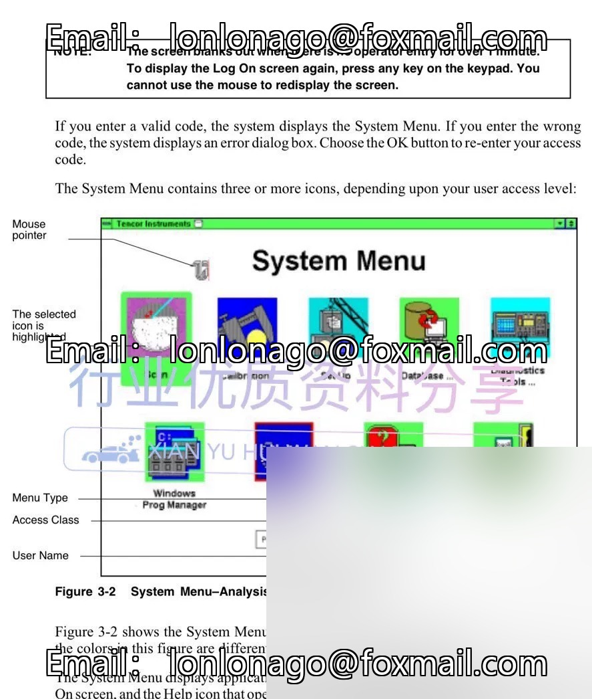
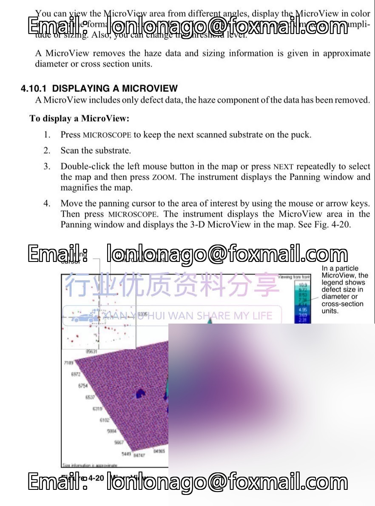
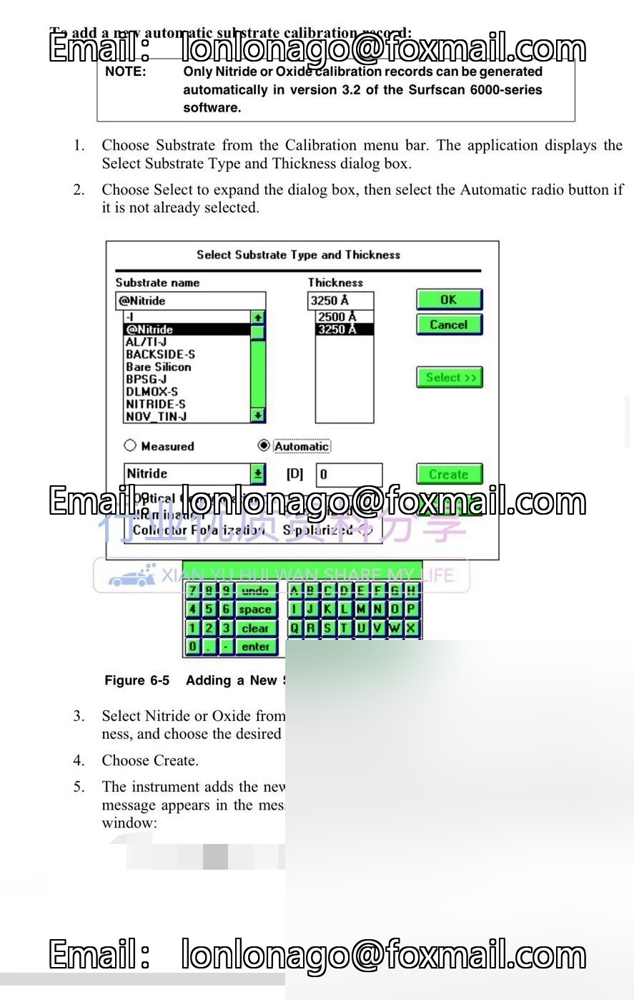
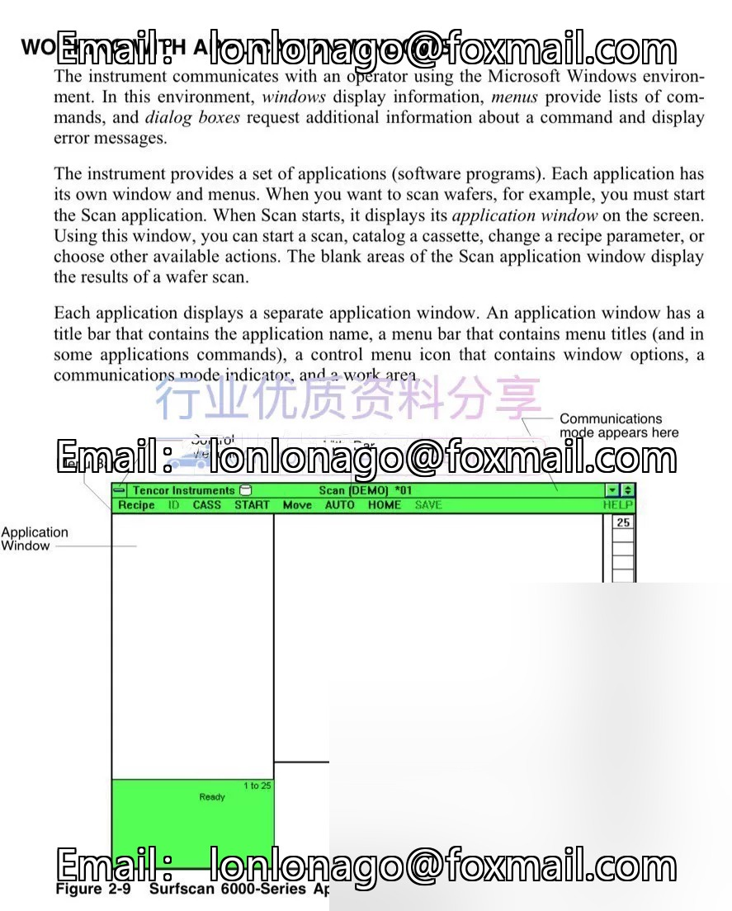
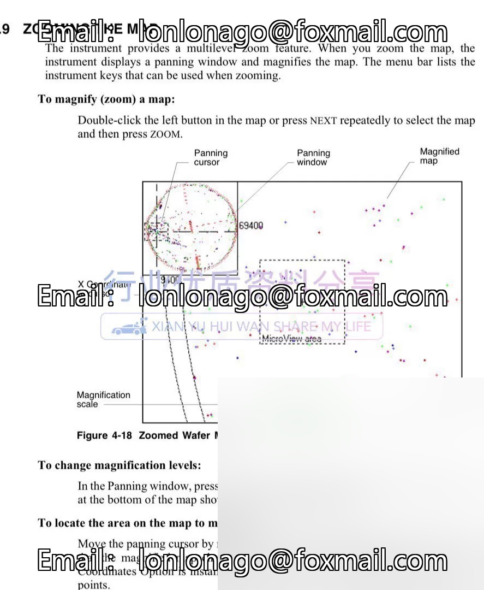
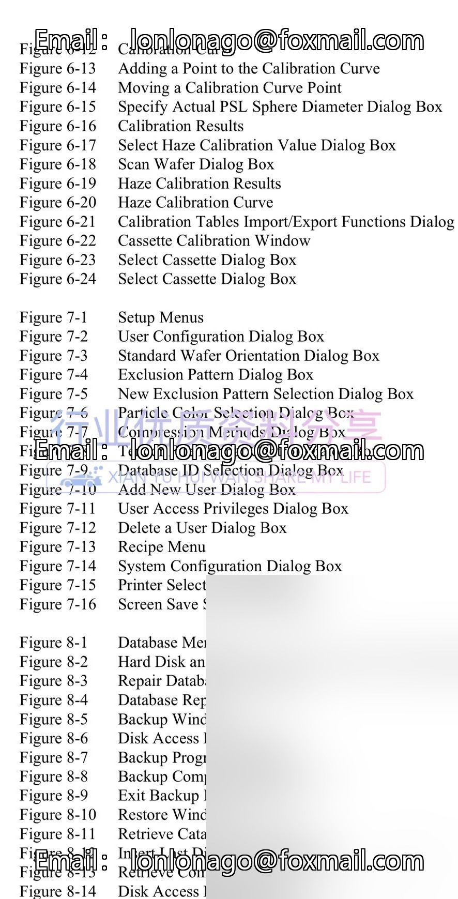
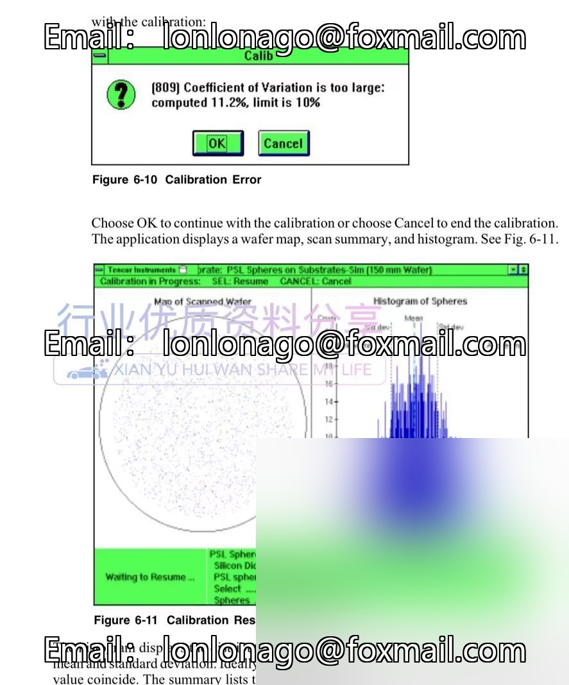
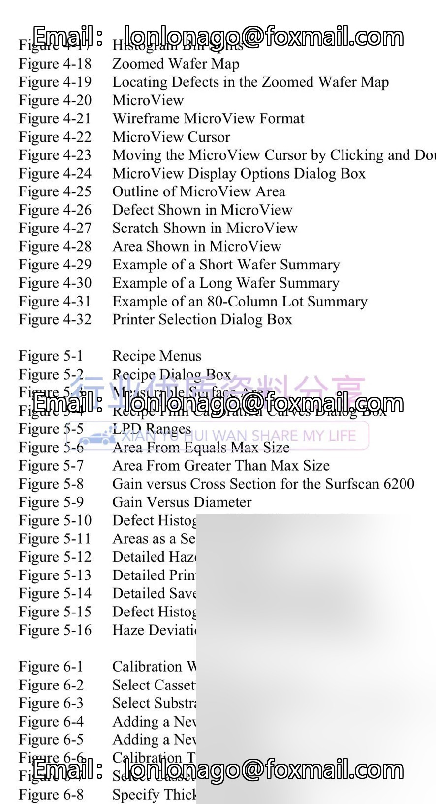
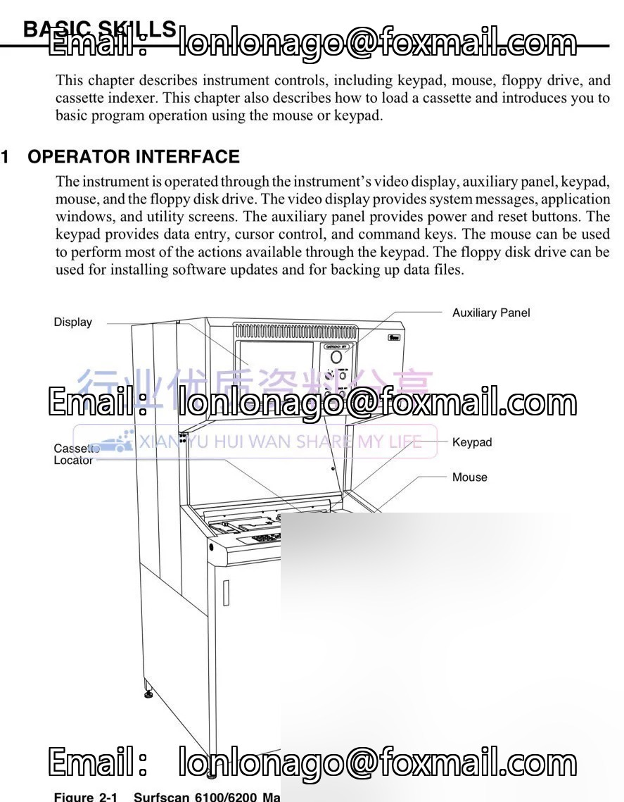

# #pdfKLA-6200 wafer surface analysis system operation manual! Very cost-effective

## Body

# pdfKLA-6200 Wafer Surface Analysis System Operating Manual! Highly valuable materials! Especially valuable for friends in equipment operation, software development, and mechanical research and development! Total 278 pages! Ultra-! Original English manual.

Take a photo and directly send the electronic original file! Since the electronic file materials have copyability, it is not allowed to return the purchase for electronic files! Thank you for understanding!

The operation manual for the pdfKLA-6200 wafer surface analysis system is provided, spanning 278 pages and covering device operation, software development and mechanical R&D.

<!-- AI_ENRICHED -->

## Images

## Payment

Here is a pay link on Stripe ( https://buy.stripe.com/3cs8yP7sY87d0vu9AB ). Please contact me lonlonago@foxmail.com after funding $89, and I will send you a complete data files , thank you!

